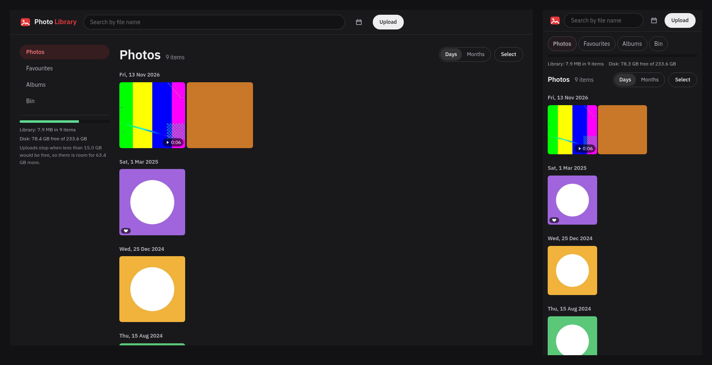

<div align="center">

# Starfire Photos

**Your own free take on Google Photos. Upload photos and videos from a phone browser, see them on a timeline by the day they were taken, and keep albums, favourites and a bin, all on your own machine.**

[](https://www.python.org/)
[](https://flask.palletsprojects.com/)
[](https://sqlite.org/)
[](LICENSE)

</div>



## Overview

- **Uploads from the phone browser.** Pick many files at once. Each file goes up in 4 MB pieces with a progress bar. If the connection drops, the upload waits and carries on from the last piece the server has; if the page was closed, pick the same files again and they continue where they stopped.
- **Timeline** grouped by day or by month, newest first, using the date the photo was taken (from its EXIF details), then the file's own date, then the upload time.
- **Thumbnails and previews** are made on upload with Pillow. iPhone HEIC photos work through pillow-heif. A file Pillow cannot read is still kept and shows a clear "No preview" tile with a download button.
- **Videos** are stored as they are and play in the browser. With ffmpeg installed they get a poster frame, a length badge and their recorded date. Browsers that cannot play a format (for example HEVC `.mov` on some Android phones) get a "download it instead" note.
- **Full-screen viewer** with swipe left and right, swipe down to close, arrow keys, details panel, favourite, add to album, download original and move to bin.
- **Albums**, **favourites** and a **bin** that deletes items for good 30 days after they were binned.
- **Search** by file name and by date range.
- **Duplicates are stored once.** Every file is identified by its SHA-256; uploading the same photo again just points at the copy you have (and brings it back if it was in the bin).
- **Disk guard.** Uploads are refused when they would leave less free disk space than `MIN_FREE_GB`. The side bar shows how much the library uses and how much is free, and a banner says so when uploads are paused.

## Requirements

- Python 3.11 or newer
- `ffmpeg` and `ffprobe` on the PATH for video posters and dates (optional; without them videos are stored and play, with a plain tile)
- Python packages from `requirements.txt`: Flask, waitress, Pillow and pillow-heif

## Install and run on your own machine

```bash
python3 -m venv .venv
.venv/bin/pip install -r requirements-dev.txt
cp .env.example .env
.venv/bin/python -m photos
```

Open http://127.0.0.1:8098 and make the owner account (see below). If you set `AUTH_MODE=local` instead, there is no sign-in, so the app only listens on 127.0.0.1 and only answers requests addressed to localhost.

### First run and sign-in

Starfire Photos has its own sign-in, switched on by default (`AUTH_MODE=builtin`).
There is one owner account and no sign-up page.

1. Start it (`.venv/bin/python -m photos`) and open
   `http://127.0.0.1:8098`. With no account yet every page goes to
   **Set up**.
2. The app writes a one-time setup code to its log when it starts, a line
   like `no owner account yet: open /setup and enter the setup code ...`.
   Enter that code, a user name and a password (10 characters or more,
   twice). The code stops anyone else who reaches the page first from
   making the account, and it works once: if the owner file is ever
   deleted, the next visit to **Set up** writes a new code to the log.
3. After that, every page goes to **Sign in** until you sign in. A session
   lasts 30 days. `/signout` signs out on every device.

How it is protected:

- The password is stored as an scrypt hash in `DATA_DIR/owner.json`
  (mode 600), never in plain text.
- 5 wrong passwords or setup codes from one address within 15 minutes lock
  that address out for the rest of the 15 minutes (`429`). Attempts sent
  at once are counted before they are checked, IPv6 addresses count by
  their `/64` network, and after 100 failures from everywhere within 15
  minutes each address gets one try and each network three (IPv4 by `/24`,
  IPv6 by `/48`). A right password from a locked address is refused too.
- During such an attack one wrong password from a neighbour on the same
  provider network does not keep your new browser out: that takes three
  wrong passwords within 15 minutes from three of their addresses (IPv4)
  or three of their home lines (IPv6, where a line's whole `/56` counts as
  one address).
- A browser that has signed in before keeps a signed device cookie and has
  its own 5 tries, so a stranger who locks out your address (or the
  address of the proxy in front) cannot lock you out of that browser.
  During an attack from many networks that browser is the way in.
  Making a new owner account ends every device cookie of the old one.
- The session cookie is `HttpOnly`, `SameSite=Lax` and signed with the app's
  secret key. It is `Secure` everywhere except plain `http` on `localhost`,
  `127.0.0.1` or `[::1]` (`SECURE_COOKIES=auto`). On a plain `http` address
  on your home network the browser drops a `Secure` cookie and the sign-in
  page says so: use https, or set `SECURE_COOKIES=false` there.
- Forget the password? Stop the app, delete `DATA_DIR/owner.json`, start it
  again and set up a new owner with the new setup code from the log. Your
  data stays.

Behind a reverse proxy for https, with the own sign-in still on: list the
proxy's address in `TRUSTED_PROXIES` so the lockout counts each visitor's
address from `X-Forwarded-For` instead of the proxy's (the header is read
only from those addresses), and put the public host name in
`ALLOWED_HOSTS`. By default the own sign-in answers only on `localhost`,
`127.0.0.1`, `[::1]`, IP addresses and this machine's own name; any other
`Host` gets `421`, so a web page cannot reach a copy on your machine by
DNS rebinding.

To run it behind a sign-in proxy instead, set `AUTH_MODE=proxy` and list the
proxy's address in `TRUSTED_PROXIES`. The user header is then believed only
from those addresses; in the default mode it is never read.

### Keep it running in the background

To keep it running on a laptop, with the data in `~/.local/share/photos` and uploads stopped while less than 30 GB of the disk would be free, run it as a transient user unit (it does not start again after a reboot), capped at 4 GB of memory. From the Photos folder:

```bash
systemd-run --user --unit=photos-laptop -p MemoryMax=4G -p WorkingDirectory="$PWD" \
  --setenv=AUTH_MODE=local --setenv=LOCAL_USER=me --setenv=BIND_HOST=127.0.0.1 --setenv=PORT=8098 \
  --setenv=DATA_DIR="$HOME/.local/share/photos" --setenv=MIN_FREE_GB=30 \
  "$PWD/.venv/bin/python" -m photos
```

Stop it with `systemctl --user stop photos-laptop` and read its log with `journalctl --user -u photos-laptop`.

## Configuration (`.env` or environment)

| Name | Default | Meaning |
|---|---|---|
| `AUTH_MODE` | `builtin` | `builtin` is the app's own sign-in with one owner account; `proxy` trusts a user header from a sign-in proxy listed in `TRUSTED_PROXIES`; `local` has no sign-in and listens on loopback only |
| `LOCAL_USER` | `local` | the user name in `local` mode |
| `BIND_HOST`, `PORT` | `127.0.0.1`, `8098` | where the app listens |
| `DATA_DIR` | `./data` | the database, the owner account (`owner.json`), originals, previews and unfinished uploads |
| `TRUSTED_PROXIES` | empty | in `proxy` mode, the addresses allowed to send the user header (public networks are refused); `proxy` mode refuses to start without it In `builtin` mode, the proxies whose `X-Forwarded-For` gives the visitor's address to the lockout. |
| `SECURE_COOKIES` | `auto` | in `builtin` mode the session cookie is `Secure` except on plain `http` to localhost, 127.0.0.1 or [::1]; `true` or `false` force it |
| `USER_HEADER` | `X-Forwarded-User` | the header that carries the signed-in user |
| `ALLOWED_USERS` | empty (anyone the proxy names) | comma separated users allowed in |
| `ALLOWED_HOSTS` | empty | the only host names the app answers on (others get 421); `/api/health` answers on any. Empty in `proxy` mode: any name. Empty in `builtin` mode: `localhost`, `127.0.0.1`, `[::1]`, IP addresses and this machine's own name |
| `SECRET_KEY` | empty (a key file is made in `DATA_DIR`) | signs the CSRF token and the session cookie; at least 32 bytes if set |
| `MIN_FREE_GB` | `15` | uploads stop when they would leave less free disk than this |
| `MAX_FILE_MB` | `4096` | the largest single file |
| `MAX_MEGAPIXELS` | `120` | larger images are refused, to stop image bombs; see the memory note below |

## What is stored where

```
DATA_DIR/
  photos.db                    SQLite: items, albums, unfinished uploads
  secret_key                   made on first start, mode 600
  owner.json                   the owner account (builtin sign-in), mode 600
  originals/ab/<sha256>.<ext>  the files exactly as uploaded
  renditions/ab/<sha256>-thumb.jpg, <sha256>-preview.jpg
  incoming/<id>.part           uploads still arriving
```

An upload that never sent a byte is cleared after an hour, one with bytes after 3 days untouched. Finished uploads are remembered for a day, so asking to finish again (after a lost reply) gives the same answer. Room for uploads still arriving is held back from the disk floor until they finish or are cleared, and `/api/storage` shows it as `reservedBytes`; the page lets go of failed and dismissed uploads straight away.

File names from the phone are only ever shown and used as the download name; nothing on disk is named after them. The extension on disk comes from the file's real type.

## How uploads and files are kept safe

- **Type by content.** The first bytes of each finished upload decide what it is: JPEG, PNG, GIF, WebP, HEIC/HEIF, AVIF, MP4, MOV, 3GP, WebM or MKV. Anything else (HTML, SVG, archives, programs) is refused with 415 and removed. The browser's MIME type and the file name are never trusted.
- **Image bombs.** Pixel counts are checked from the header before anything is decoded, and refused above `MAX_MEGAPIXELS`. Images are shrunk to preview size straight after decoding, before any other copy is made.
- **Memory.** Measured peaks for a 119 megapixel image: JPEG about 90 MB (progressive 390 MB), PNG 650 MB (with see-through pixels 1.1 GB), WebP 1.8 to 2.0 GB (Pillow's WebP decoder keeps several full copies), HEIC 48 MP 360 MB. The container's `mem_limit` of 2560 MB covers the worst of these at `MAX_MEGAPIXELS=120`; `tests/test_deploy.py` measures it again and fails if the two stop agreeing. Lower both together.
- **A crash while adding a file** (for example the memory cap) is not retried for ever: the upload is marked as being added before the work starts, and if the server stops part way the next finish answers 422 and the page stops.
- **Damaged images** (cut short, bad EXIF, odd HEIC or AVIF) are kept as items with a "no preview" tile; half-written previews are removed.
- **ffmpeg and ffprobe** run with `-protocol_whitelist file`, so a video cannot make them fetch anything.
- **Size caps.** Each request is at most 8 MB plus a little JSON, each file at most `MAX_FILE_MB`, and the disk floor is checked when an upload starts (counting other uploads still arriving) and again for every piece.
- **Writes** need the CSRF token from `/api/session` and are refused when the `Origin` header names another site.
- **Serving files.** Thumbnails and previews are JPEGs the app made itself, cached for a year only when the URL carries the item's `?v=` version (the first 16 hex characters of its hash), so a number reused after a database restore can never show an old picture. Item numbers are never reused (`AUTOINCREMENT`; older databases are moved over on start). Originals are sent as attachments, and the download name gets the real type's extension added when the uploaded name did not have it (`holiday.html` becomes `holiday.html.jpg`). Videos play inline with their real video type. Every response carries `X-Content-Type-Options: nosniff`; files under `/media/` also carry `Content-Security-Policy: default-src 'none'; sandbox`, so nothing uploaded can run as a page.
- **Paths.** Items are looked up by number and stored by hash, upload ids must be 32 hex characters, and static files are served only from the app's own folder. There are no zip uploads or downloads, so there is nothing to unpack.

## Running it on a server

On that server Starfire Photos trusts the gate instead of its own sign-in: `deploy/photos.env` sets `AUTH_MODE=proxy` and `TRUSTED_PROXIES` to the proxy container's address (`PROXY_ADDRESS` from `deploy/site.env`).

`deploy.sh` runs Starfire Photos in Docker in one Proxmox container (the app container) and puts it behind the starfire admin login in the container that runs Caddy (the proxy container). It was tried for real in a test round (backup, apply, check, uploads, restart, undo, twice); the 119 MP WebP peaked at 2.0 GB in the container.

The values for your own setup live in `deploy/site.env`, which git ignores. Copy `deploy/site.env.example` and fill it in:

| Key | Description |
|---|---|
| `PROXMOX` | The ssh host name of the Proxmox machine. |
| `APP_CT` / `PROXY_CT` | The numbers of the app container (Docker) and the proxy container (Caddy). |
| `SITE_HOST` | The host name Starfire Photos is served on, like `photos.example.com`. |
| `SIGNED_IN_USER` | The starfire admin account name; Caddy passes it on and it becomes `ALLOWED_USERS`. |
| `APP_ADDRESS` | The app container's LAN address; the port is published only there. |
| `PROXY_ADDRESS` | The proxy container's LAN address, the only one the app trusts and the firewall lets in. |
| `DATA_PATH` | Where the photos live on the app container, like `/srv/photos-data`. |
| `OTHER_SITES` | Optional comma separated host names of other sites behind the same Caddy, which `check` makes sure still answer. |

- `deploy/Dockerfile` and `deploy/compose.yaml`: Python 3.13 slim with ffmpeg, runs as uid 65532 on a read-only root, all capabilities dropped, 2560 MB memory cap (see Memory above), port published only on `APP_ADDRESS:5004`.
- `deploy/photos.env`: proxy mode, trusts only `PROXY_ADDRESS`, admin only, answers only on `SITE_HOST`, 15 GB disk floor.
- `deploy/Caddyfile.photos`: the proxy container's site block, a copy of the Keep Notes block (sign-in page, `forward_auth` to starfire's admin check, the visitor's `X-Forwarded-User` dropped and replaced).
- `deploy.sh backup | apply [commit] | check | undo` from your own machine:
  - `backup` saves `/opt/photos`, `/etc/photos`, `/etc/ufw/after.rules` and a copy of the database in the app container (copied through `DATA_PATH`, since the container's `/tmp` is a tmpfs `docker cp` cannot read), and the Caddyfile and sign-in page in the proxy container. The photos themselves are not copied.
  - `apply` refuses unless both containers have a backup from the last hour, then puts the code in `/opt/photos`, writes `/etc/photos/photos.env` once, makes `DATA_PATH` for uid 65532, adds a marked `DOCKER-USER` rule to `/etc/ufw/after.rules` that drops port 5004 for everyone except the proxy container and reloads ufw, and only then runs `docker compose up -d --build`. In the proxy container it takes `/root/caddy-edit.lock`, installs the sign-in page, appends the marked Caddy block (or, when it is already there, only brings its 403 text up to date), validates and reloads.
  - `check` shows the container health, the live drop rule (matched in whatever order `iptables -S` prints it), the sign-in redirects through Caddy, that the other sites still answer, and that the proxy container reaches the app: `/api/session` with `X-Forwarded-User` answers 200, without it 401.
  - `undo` removes what the last apply added; `DATA_PATH` is never touched.
- After apply, the Cloudflare tunnel needs a public hostname for `SITE_HOST` pointing at port 80 of the proxy container.

Before moving, check the free space where `DATA_PATH` lives (the 15 GB floor counts against it) and copy `~/.local/share/photos` across to keep the laptop library.

## API

All JSON. Writes need the `X-CSRF-Token` header from `GET /api/session`.

| Method and path | What it does |
|---|---|
| `GET /api/health` | `{"ok": true}` without signing in |
| `GET /api/session` | user, CSRF token, chunk size, file size limit, bin days |
| `GET /api/storage` | disk total, free, floor, `reservedBytes` held for uploads still arriving, room left, library size and count |
| `GET /api/media?view=timeline\|favourites\|bin\|album&album=&q=&from=&to=&cursor=&limit=` | a page of items, newest taken first, with `nextCursor` |
| `GET /api/media/<id>` | one item with its albums |
| `POST /api/media/bulk` `{action, ids}` | `favourite`, `unfavourite`, `trash`, `restore`, `delete` (bin only) |
| `POST /api/bin/empty` | delete everything in the bin now |
| `GET/POST /api/albums`, `GET/PATCH/DELETE /api/albums/<id>` | list, make, read, rename, delete (photos stay) |
| `POST /api/albums/<id>/add`, `/remove` `{ids}` | put items in or take them out |
| `POST /api/uploads` `{name, size, fingerprint, fileTime}` | start or resume an upload; the same fingerprint resumes |
| `GET /api/uploads/<id>` | how many bytes the server has |
| `PUT /api/uploads/<id>` with `Upload-Offset` | one piece; a wrong offset answers 409 with `received` |
| `POST /api/uploads/<id>/finish` | check, store, make previews; says if it was a duplicate; asking again answers the same; 422 if the server stopped while adding it |
| `DELETE /api/uploads/<id>` | give up an upload |
| `GET /media/<id>/thumb`, `/preview`, `/play`, `/original` | the files (play supports range requests); add `?v=<version>` from the item for long caching |

## Tests

```bash
.venv/bin/python -m pytest -q
```

The video tests make a short clip with ffmpeg and are skipped when it is not installed.

## Tech

Python, Flask and waitress, SQLite, Pillow and pillow-heif, ffmpeg for video posters, and plain HTML, CSS and JavaScript with the IBM Plex fonts.

## Android app

`android/` holds a small Android app (Kotlin, one WebView) that opens your Starfire Photos server full screen. The first time it opens it asks for your server address, checks that the server answers, and remembers it. Change it later from the long-press menu on the app icon ("Change address") or from the link on the offline page. The app needs Android 10 or newer and asks only for the internet permission.

Release builds are signed with `~/.starfire-photos-release.jks` (password in `~/.starfire-photos-release.pass`), or with `STARFIRE_KEYSTORE`, `STARFIRE_KEYSTORE_PASSWORD` and `STARFIRE_KEY_ALIAS` when those are set. Without a release key the build stops; add `-PallowDebugSigning` to sign with the debug key instead.

```bash
cd android
./gradlew testPublicDebugUnitTest
./gradlew assemblePublicRelease
```

The APK is `app/build/outputs/apk/public/release/app-public-release.apk`. To build a private edition with your address built in and the setup screen skipped, copy `android/private-address.example.properties` to `android/private-address.properties` (git-ignored) and run `./gradlew assemblePrivateRelease`.

### Security notes

- Only https addresses are accepted, with a full host name and no user name or password in them. Plain http is refused, even on a home network.
- Only your server's host (plus any extra hosts you add on the setup screen) opens inside the app. Every other link opens in the browser.
- If sign-in sends you to another host, add that host as an extra host, or the app shows a blank page and the browser opens.
- Downloads send your session cookie only when the download address is one of your hosts. Android's download manager repeats request headers on redirects, so keep download redirects on your own hosts.
- The app has no JavaScript bridge, never accepts a bad TLS certificate (it shows the offline page instead), and keeps backups off.

## License

MIT, see [LICENSE](LICENSE). The IBM Plex fonts are under the SIL Open Font License, see `photos/static/fonts/LICENSE-ibm-plex.txt`.
